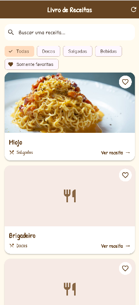
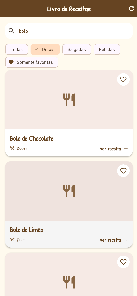
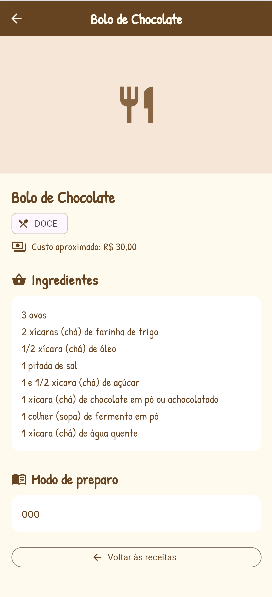
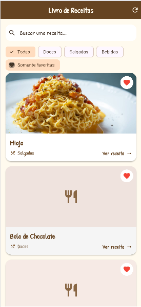

# 📚 Livro de Receitas

Aplicativo desenvolvido em Flutter para consultar receitas, visualizar seus ingredientes e modo de preparo atravez da API.

## Funcionalidades

- Listar receitas da API.
- Pesquisar receitas pelo nome.
- Filtrar receitas por tipo.
- Favoritar receitas.
- Visualizar os detalhes de cada receita.
- Salvar os favoritos no dispositivo.

## Tecnologias utilizadas

- Flutter
- Dart
- API REST
- Shared Preferences

## Download do aplicativo

📲 [Clique aqui para baixar o APK](./assets/app-release.apk)

## Prints do aplicativo

| Tela inicial | Lista de receitas |
|:---:|:---:|
|  |  |

| Pesquisa e filtros | Detalhes da receita |
|:---:|:---:|
|  |  |

| Receitas favoritas |
|:---:|
|  |

## Autora

**Isabelle Borges 🩷**
